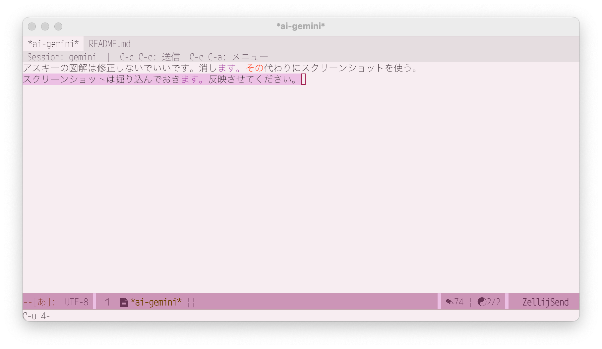
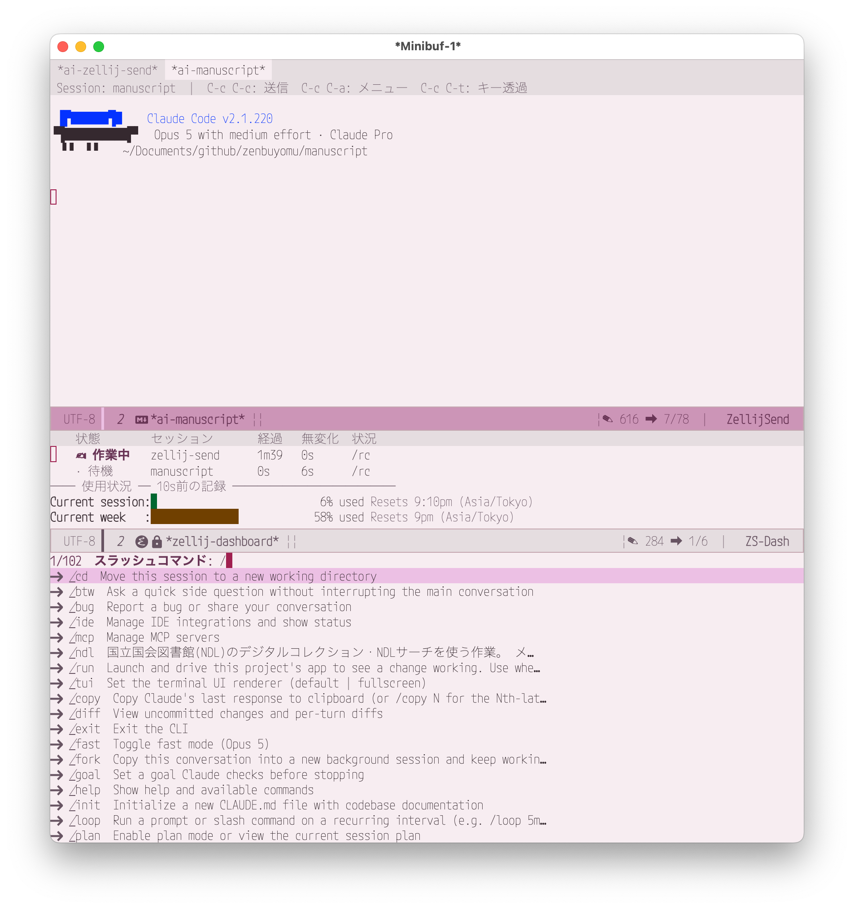
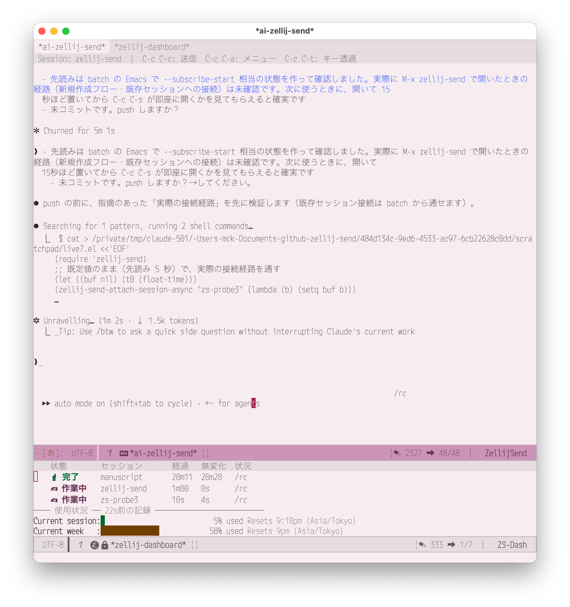

# zellij-send.el

[English](README.md) | 日本語

Emacs から detached の AI エージェントを運用する拡張です。
[zellij](https://zellij.dev/) のセッションひとつひとつが、書いて読むだけの普通の
Emacs バッファになります。Emacs の中にターミナルエミュレータは要りません。
attach するクライアントも、開いたままにしておく窓も要りません。

## 概要

`M-x zellij-send` で **detached** な zellij セッションを作り、ペインでエージェント
（既定は `claude`）を起動し、`*ai-セッション名*` バッファを黒板として渡します。
書いて `C-c C-c` で送ると、ペインの画面が同じバッファに返ってきます。



セッション名と必要なキーはヘッダ行に出ます。

何も attach していないので、開いたままにしておくものがありません。よそ見をしている
間もエージェントは動き続け、Emacs を再起動してもダッシュボードが動いている
セッションを勝手に拾い直します。同時に何本も走らせれば、どれが作業中で、どれが
終わっていて、どれが返事を待っているかを一覧で教えてくれます。

## なぜこのツール？

Emacs はあらゆるものがテキストであり、すべてのバッファが等価に存在するという
世界観で作られています。エージェントとの会話もテキストなら、それが編集している
ファイルも、いま下書きしている文章も、1 時間前に言ったことのログもテキストです。
エージェントをバッファに置くということは、開いている他のすべてと同じ世界に
置くということで、これはある働き方に向いています。

> Emacs はあらゆるものがテキストであるという一貫性があり、すべてのバッファが
> 等価に存在するという世界観で作られているので、「様々な場所にあるファイルを開き、
> 気が向いた作業をちょろちょろしながら過集中が起きるのを待つ」という人には向いている。

目指しているのは、片方のバッファでエージェントにソフトウェアを作らせながら、
もう片方では別のエージェントに文章の下書きを手伝わせ、注意が向いたほうへ
移っていくための作業台です。要は**ちょろちょろするコストが低いこと**が主眼です。

- **エージェントは窓より長生きする。** フレームを閉じても、Emacs を再起動しても、
  翌日でも、ターミナルで `zellij attach` すれば同じセッションがそこにあります。
- **同時に何本も、が普通の使い方。** [ダッシュボード](#ダッシュボードzellij-send-dashboardel)が
  全セッションの状態を並べるので、詰まっているものが訪ねなくても分かります。
- **文章を作るのはターミナルではなく Emacs。** インプットメソッドも、abbrev も
  スニペットも、他のバッファからのヤンクも効きます。
- **会話がバッファである。** `C-c C-a` → `a` は Claude Code の transcript から
  会話を丸ごと組み直すので、画面から流れて消えた分も失われません。

### `vterm` / `eat` でインプットメソッドが壊れる人へ

これがこの拡張ができた元々の理由です。`vterm` や `eat` は、キー入力を子プロセスに
そのまま渡します。TUI を動かすにはそれが正しいのですが、その結果
**Emacs の中で動くインプットメソッドはキーを見る機会が一度もありません**。
OS 側の IME（macOS、ibus、fcitx）は Emacs に届く前に確定するのでたいてい平気で、
壊れるのは **Emacs 自身の入力**です。

| | |
|---|---|
| 日本語 | [ddSKK](https://github.com/skk-dev/ddskk) — 変換処理が Emacs Lisp で走る |
| 中国語 | [`pyim`](https://github.com/tumashu/pyim)、[`emacs-rime`](https://github.com/DogLooksGood/emacs-rime) |
| ロシア語・ギリシャ語ほか | `C-\` と `russian-computer` など。**OS** のレイアウトを切り替えるとキーバインドが全滅するので、Emacs 側の入力メソッドが定石になっている |
| ベトナム語・インド系諸語 | 組み込みの Quail（`vietnamese-telex`、`devanagari-itrans` など） |
| 言語ですらないもの | `agda-input`、`lean4-input`、`TeX` メソッド |

この表に入っているなら、入力が効く普通の Emacs バッファで文章を作り、
TUI が機嫌よく動くペインへ zellij-send に届けさせてください。

## 必要環境

- Emacs 28 以上（`transient` 内蔵）
- [zellij](https://zellij.dev/) **0.44 以上**が `$PATH` に通っていること
- [`markdown-mode`](https://github.com/jrblevin/markdown-mode)（オプション）：黒板にマークダウン装飾が付きます
- Stop フック・使用状況を使う場合は `python3`

## インストール

```elisp
;; 手動
(add-to-list 'load-path "/path/to/zellij-send")
(require 'zellij-send)

;; use-package + elpaca
(use-package zellij-send
  :ensure (zellij-send :url "https://github.com/ichibeikatura/zellij-send.el"))
```

## 使い方

### 1. セッションを開く

`M-x zellij-send` で起動中の zellij セッション一覧が出ます。選ぶと `*ai-セッション名*` バッファが開きます。

`[New]` を選ぶと、作業ディレクトリと起動コマンド（既定 `zellij-send-default-command` = `claude`）を聞いて新しいセッションを作ります。セッション名は**ディレクトリ名 + 2 桁の連番**（`myproj00`）です。セッションは detached のまま作られ、ペイン ID を覚えて送受信するので、ターミナルでの attach は要りません。生で見たいときは任意のターミナルで `zellij attach セッション名`。

**既存セッション**に接続したときは、作業ディレクトリと送り先のペイン・動いているコマンドを zellij から復元します（`list-panes --all` の COMMAND 列でエージェントのペインを選ぶ）。ペインが特定できなかったときだけフォーカス中のペインに送るので、その場合は attach 中のクライアントが必要です。

### 2. テキストを送信

バッファに書いて `C-c C-c`。送信に成功し、送信開始から編集していなければバッファを空にします。送信中に編集した場合や失敗した場合は内容を残します。

### 3. 回答を読む

黒板はペインの画面を常時映しています（`zellij subscribe`）。カーソルが末尾にある間は更新されても末尾を追い、上へ動かして読み始めるとその位置に留まります（`M->` で再び追う）。

**バッファを編集している間とクリアした後は、自動更新が止まります**（下書きを上書きしないため）。画面が固まったように見えたら `C-c C-a` → `g` で戻してください。

見えるのは 1 画面分です。全画面 TUI にはスクロールバックが無いので、会話を最初から読むには `C-c C-a` → `a`（Claude Code の transcript から組み直す）を使います。

## キーバインド

`*ai-セッション名*` バッファ内:

| キー      | 動作                                   |
|-----------|----------------------------------------|
| `C-c C-c` | テキストを送信（バッファはクリア）     |
| `C-c C-a` | メニューを開く                         |
| `C-c C-k` | 処理を中断（Esc を送る）               |
| `C-c C-q` | 画面の質問に答える（AskUserQuestion）  |
| `C-c C-t` | キー透過モードの切り替え（キーがペインに届く） |
| `C-c C-s` | スラッシュコマンドを選んで送る（`C-u` で一覧を取り直す） |
| `M-p` / `M-n` | 送信済みのテキストを呼び戻す       |

### メニュー（`C-c C-a`）

**表示**

| キー | 動作                                                                 |
|------|----------------------------------------------------------------------|
| `d`  | ダッシュボード（全セッション一覧）を開く                             |
| `a`  | 会話を最初から表示（transcript から。`C-u a` は画面をダンプ）        |
| `g`  | いまの画面に戻す（取り直して自動更新を再開）                         |
| `l`  | 出力ログを開く（markdown。Stop フックが書く）                        |
| `x`  | バッファの内容をクリア                                               |
| `w`  | 画面の折り返しを切り替える（表を見るとき）                           |
| `=`  | 直近の編集（Edit / Write）を diff で見る（Claude Code。ファイルは変えない） |

**送信**

| キー | 動作                                            |
|------|-------------------------------------------------|
| `e`  | 返信バッファを開く（回答を読みながら返信）      |
| `n`  | 数字を送る（入力プロンプトあり）                |
| `h`  | 送信履歴から選ぶ                                |
| `u`  | 画面の質問に答える（AskUserQuestion）           |
| `k`  | キー透過モード（↑↓ / RET / SPC がペインに届く） |

**命令**

| キー | 動作                                         |
|------|----------------------------------------------|
| `i`  | 処理を中断（Esc を送る）                                               |
| `/`  | スラッシュコマンドをミニバッファで選んで送る（`/compact`・`/clear` もここから） |
| `s`  | 決定事項を `CLAUDE.md` 等に反映するよう依頼（`C-u s` は作業ログを別ファイルへ） |
| `+`  | エージェントを増やす（同じディレクトリにもう 1 体）                    |
| `q`  | セッションを削除（zellij セッションを消してバッファを閉じる。確認あり） |

### 作業の記録（`s`）

`s` はエージェントに「恒久的な決定事項（制約・設計判断とその理由・禁止事項）だけを、**追記ではなく更新として**反映して。重複はまとめ、古い記述は消し、作業の経過は書かない」と頼みます。書かせる先はエージェントごとに `zellij-send-agents` の `:progress-file`（claude は `CLAUDE.md`、codex は `AGENTS.md`、agy は `GEMINI.md`）。

その場の作業ログを残したいときは `C-u s` です。`zellij-send-progress-log-file`（既定 `.zellij-send/worklog-%Y-%m-%d.md`、日付入り）に書かせ、`CLAUDE.md` 等には書かせません。

### エージェントを増やす（`+`）

**いまのバッファと同じディレクトリ・同じコマンド**でもう 1 体立ち上げます。セッション名は空いている連番（`myproj00` から呼べば `myproj01`）。別のコマンドで増やすときは `C-c C-a C-u +`（メニューを開いてから `C-u`）。エージェント 1 体につき zellij セッション 1 つなので、送信・自動受信・終了はバッファ単位で効き、ダッシュボードには別行で並びます。

### 複数の CLI（Claude Code / Codex / …）

セッションごとに違うコマンドを動かせます。候補は `zellij-send-agents` の名前（claude・codex・agy。一覧に無いコマンドも入力可）。`zellij-send-default-command`（claude）以外を動かしているバッファでは、ヘッダ行にコマンド名が出ます（`Session: myproj00 [codex]`）。

| 機能 | claude | codex | agy | その他 |
|---|---|---|---|---|
| 送信・送信履歴・返信バッファ | ○ | ○ | ○ | ○ |
| 画面表示（自動受信）・ダッシュボード | ○ | ○ | ○ | ○ |
| **キー透過モード（`C-c C-t`）** | ○ | ○ | ○ | ○ |
| 中断（`C-c C-k`）・終了（`q`） | ○ | ○ | ○ | ○ |
| 選択肢の検出・ハイライト | ○ | ○ | ○ | 記号次第 |
| 数字での回答（`n` / ダッシュボードの `1` `2` `3`） | ○ | **×** | ○ | — |
| `/clear` | ○ | ○ | ○ | — |
| `/compact` | ○ | ○ | **×** | — |
| 会話を最初から読む（`a`）・出力ログ（`l`） | ○ | — | — | — |
| スラッシュコマンド補完（`/`） | ○ | — | — | — |
| AskUserQuestion への回答（`u` / 自動起動） | ○ | — | — | — |
| 使用状況バー | ○ | — | — | — |

下の 4 行は Claude Code の画面の形や transcript を読むので、他の CLI では `user-error` で止まります。選択肢・権限ダイアログ・設定画面は**キー透過モード**で操作してください（画面を解釈しないので、どの TUI にも効きます）。

`×` は実機で確かめた結果です。CLI ごとに違うことは 1 つの対応表 `zellij-send-agents` にまとめてあり、その `:capabilities` には**実機で確認したものだけ**が入っています。未確認の能力を足さないでください（エージェントの自己申告は根拠になりません）。

4 体目の CLI を足すときは、1 行足して、実機で確かめた能力だけを書きます（能力の一覧は `zellij-send--capabilities`）。

```elisp
(add-to-list 'zellij-send-agents
             '("mycli" :prompt-marker "[❯›]" :progress-file "AGENTS.md"
               :capabilities (clear))
             t)
```

2026-10 までは 6 つの別々の設定でした。それらは削除したので、設定していた場合は次のように移してください。

| 旧設定 | 移す先 |
|---|---|
| `zellij-send-commands` | `zellij-send-agents` の名前 |
| `zellij-send-prompt-marker-alist` | `:prompt-marker`（省くと `zellij-send-prompt-marker-regexp`） |
| `zellij-send-number-reply-commands` | `:capabilities` の `number-reply` |
| `zellij-send-slash-support-alist` | `:capabilities` の `compact` / `clear` |
| `zellij-send-progress-file-alist` | `:progress-file`（省くと `zellij-send-progress-file-default`） |
| `zellij-send-interpreters` | 設定ではなくなった（固定: node・bun・deno・python・ruby・perl・npx・uv など） |

### 送信履歴

送信したテキストはセッションごとに記憶されます（`zellij-send-history-max`、既定 50）。`M-p` で遡り、`M-n` で戻ります。最新より先に戻ると、辿り始める前の下書きに復帰します。`C-c C-a` → `h` は補完で選べます。

### スラッシュコマンド（`C-c C-s`）



Claude Code のスラッシュコマンドを全部ミニバッファから選んで送れます。一覧はペイン自身の補完メニューから読むので、いま使えるコマンド（組み込み・スキル・プロジェクトのコマンド）と一致します。

引数を取るコマンドは確定後に引数も尋ねます。`/effort  [low|medium|…]` のような選択肢は補完候補に、`<path>` はディレクトリ補完に、`/config`・`/plugin` のようにペインで選ぶ候補は集めてミニバッファに出します（入れ子なら 1 段ずつ）。候補に無い文字列を打って `RET` すると、それで絞り込んで出し直します。

一覧の取得には数秒かかるので、黒板を開いた数秒後に裏で先読みします。**一覧を読むのは一度だけで、プロジェクトをまたいで共有**します。プロジェクトによって変わるのはそのプロジェクトの `.claude/commands` と `.claude/skills` だけなので、その分はペインに打たずにファイルから読みます。ファイルから決めきれないプロジェクト（`.mcp.json` がある、`.claude/settings.json` でプラグインを有効にしている、コマンドがサブディレクトリにある、親ディレクトリにも `.claude` のコマンドやスキルがある）だけは、これまでどおりペインから読みます。取った一覧はディスク（`zellij-send-slash-cache-directory`）にも保存するので、Emacs を再起動しても取り直しません。claude の更新やスキルの追加を見つけたとき、または `zellij-send-slash-cache-max-age`（既定 7 日）を過ぎたときは黙って取り直します。すぐ取り直したいときは `C-u C-c C-s`。先読みが邪魔なら `zellij-send-slash-prefetch` を `nil` に。取得中（先読みを含む）や AskUserQuestion への回答の途中で止めたいときは `M-x zellij-send-abort`。入力欄に打ちかけた文字も片付けます（キーには割り当てていません）。

取得はペインの入力欄を実際に打って行うため、**入力欄に書きかけのテキストがあるときは何もしません**。途中でターミナル側から打ち始めた場合もその場で中止します。

### 中断

`C-c C-k`（ダッシュボードでは `i`）でペインに `Esc` を送ります。状態を問わず実行できます。

### 返信バッファ（`C-c C-a` → `e`）

`*zellij-reply-セッション名*` が開きます。黒板で回答を読みながら別バッファで返信を書き、`C-c C-c` で送ってバッファを閉じます（ウィンドウ構成は元に戻ります）。送り先は送る時点の元の黒板から読むので、元の黒板を閉じた後は送れません（本文は残ります）。

### 会話を最初から読む（`C-c C-a` → `a`）

Claude Code の transcript（`~/.claude/projects/<slug>/` 以下の JSONL）を読み、あなたの発言・本文・thinking・ツールの呼び出しと結果を順番どおりに黒板へ流します。

- [状態フック](#3-状態フック任意ダッシュボードの判定を確かにする)を入れていれば、そのセッションの JSONL を Claude Code から教わるので選ぶ必要はありません。無ければ初回に対応する JSONL を選びます（`MM-DD HH:MM  サイズ  題名` の新しい順。候補が 1 つでも確認します）。自分で選んだものはフックより優先します。対応付けはバッファを閉じるまで保持し、更新日時から別エージェントの履歴を自動で選ぶことはありません。選び直すには `M-x zellij-send-select-transcript`。
- 表示中は自動更新が止まります。戻すには `g`。
- 画像は `[画像 image/png 66 KB]` の 1 行に、`zellij-send-transcript-max-line-length`（既定 2000 文字）を超える行は切り詰めて出します。ツールの出力が大きすぎるときは `zellij-send-transcript-max-block-lines` に行数を設定してください。
- Claude Code 以外のコマンドと `C-u a` は zellij の画面をダンプします。

### いまの画面に戻す（`C-c C-a` → `g`）

ペインを取り直して自動更新を再開します。`a` の後だけでなく、**送るのをやめた下書きを書いた後**にも使います。中身のある下書きを捨てるときは確認します。`C-u g` はスクロールバックまで取ります（全画面 TUI 以外で意味があります）。

### 選択肢プロンプトへの応答

番号付き選択肢（claude の `❯ 1.`、codex の `› 1.`、agy の `> 1.`）が出るとハイライトされます。`C-c C-a` → `n` で数字を送ります。

### 質問への回答（AskUserQuestion / `C-c C-q`）

Claude Code が枠付きの質問（`❯ 1.` の選択肢・上部のタブ・最後の *Review your answers* 画面）を出したとき、ペインから質問を読み、ミニバッファで尋ね、対応するキーをペインに送ります。

- **単一選択** — 補完で選ぶと 1 打で確定し、次の質問へ自動で進みます
- **複数選択** — `completing-read-multiple`（カンマ区切り）で選びます
- **自由入力**（`Type something`）— ミニバッファで入力した内容を欄に貼り付けます
- **確認画面** — 送信前に `y/n` で尋ねます

既定（`zellij-send-askq-auto` = `keys`）では、質問が出るとミニバッファではなく[キー透過モード](#キー透過モードc-c-c-t)に自動で入ります。説明を画面で読みながら数字キー（`↑↓` / `RET` も可）で答えてください。質問が消えると自動で解除します。ウィンドウは表示するだけで選択はしないので、打つ前にそのウィンドウへ移ってください。`minibuffer` にすると上記のミニバッファ版が自動で開き、`nil` なら `C-c C-q` で自分で開きます。途中で `C-g` を押せば、ペインの質問はそのままで抜けられます。

### キー透過モード（`C-c C-t`）

有効な間は ↑↓←→ / `RET` / `SPC` / `TAB` / `ESC` / `DEL` と印字文字が、バッファの編集ではなくペインへ送られます。権限ダイアログ、`/model` の選択、zellij-send が解釈しないメニューに使います。`C-c C-t`（メニューは `k`）か `C-g` で解除。有効中はバッファが read-only になります。

## ダッシュボード（`zellij-send-dashboard.el`）

`M-x zellij-send-dashboard`（または `C-c C-a` → `d`）で、開いている全セッションを要対応順に並べます。



| 列       | 意味                                                                  |
|----------|-----------------------------------------------------------------------|
| フラグ   | `✎` 未送信の下書きあり / `‖` クリア済み — 黒板の自動更新が止まっている |
| 状態     | 選択待ち / 完了 / 作業中 / 待機                                       |
| 経過     | その状態になってからの時間                                            |
| 無変化   | 画面が最後に変わってからの時間（詰まったセッションを見つけられる）    |
| 状況     | 画面末尾の意味のある行（スピナー行など）                              |

| キー        | 動作                              |
|-------------|-----------------------------------|
| `RET`       | そのセッションのバッファへ移動     |
| `o`         | 別ウィンドウに表示（一覧に留まる） |
| `e`         | そのセッションの返信バッファを開く |
| `1`/`2`/`3` | 選択肢を送信                       |
| `a`         | 会話履歴を表示（`C-u` で画面を取得） |
| `l`         | そのセッションのログを開く         |
| `i`         | 処理を中断（Esc を送る）           |
| `c`         | `/compact` を送信                  |
| `Q`         | セッションを終了（`C-c C-a q` と同じ） |
| `g`         | 手動更新（`revert-buffer`）        |
| `G`         | 未接続の zellij セッションに接続   |
| `?`         | キー一覧を表示                     |

`G` を押すと、まだバッファの無い起動中の zellij セッションに何も尋ねずに接続します。`zellij-send-auto-connect` を non-nil にすると（既定は nil）これを自動で行います。`zellij-send-scan-interval` 秒ごと（既定 15 秒）にセッション一覧を見て、終了したセッションの黒板と送信履歴を消します（編集中の黒板は残します。`zellij-send-prune-gone`）。`zellij-send-auto-connect` が non-nil なら、ターミナルで立ち上げたセッションもこのとき取り込みます。この見回りはダッシュボードを開いていなくても黒板がある間は続き、黒板がすべて消えたら止まります。3 つの変数は旧名の `zellij-send-dashboard-…` でも効きます。

「作業中」は、スピナー行がある**か**、画面が `zellij-send-active-window` 秒以内（既定 6 秒）に変化した場合です。[状態フック](#3-状態フック任意ダッシュボードの判定を確かにする)を入れていれば、Claude Code が知らせる状態を優先します。終わると「完了」になり、そのバッファを表示すると解除されます。状態の判定で zellij を追加で呼ぶことはありません。

`Q` は確認のうえ `/exit` を送り、エージェントの終了を待ってから zellij セッションを削除します。`zellij-send-quit-timeout`（既定 10 秒）以内に終了しなければ強制削除します。

### Remote Control

ダッシュボードからは [Remote Control](https://claude.ai/code) に接続しません。方法は 2 つあります。

- **最初から付ける（推奨）:** `zellij-send-remote-control` を `t` にします。新しく作る Claude Code のセッションが `claude --remote-control セッション名` で起動し、QR を読まなくても claude.ai やモバイルアプリにセッション名で出ます。
- **起動済みのセッションを繋ぐ:** `C-c C-s` で `/remote-control` を送り、Claude Code のメニュー（QR の表示を含む）をキー透過モード（`C-c C-t`）で操作します。

### 表示の設定

| 変数                                    | 意味                                                  |
|-----------------------------------------|-------------------------------------------------------|
| `zellij-send-dashboard-display-action`  | `display-buffer` のアクション（既定: 下部・高さ自動） |
| `zellij-send-dashboard-fit-window`      | 再描画のたびに高さを合わせる（既定 `t`）              |
| `zellij-send-dashboard-max-height`      | 高さの上限行数（既定 16）                             |
| `zellij-send-dashboard-tail-width`      | 「状況」列の幅（既定 40）                             |
| `zellij-send-dashboard-refresh-interval`| 再描画間隔・秒（既定 3）                              |
| `zellij-send-scan-interval`             | セッション検出の間隔・秒（既定 15。0 で自動検出なし） |
| `zellij-send-prune-gone`                | 消えたセッションの黒板を消す（既定 `t`）              |

`zellij-send.el` 本体（とそれが読み込む `zellij-send-*.el`）はダッシュボードに依存しません。

### 使用状況（`/usage`）を表示する

表の下に、Claude Code の `/usage` と同じセッション/週の使用状況を 1 種別 1 行で出せます。この情報の公式の取得経路は **statusLine コマンドの stdin に渡される JSON だけ**なので、それをキャッシュに保存するステータス行を設定し、ダッシュボードはそれを読みます。

**1. `~/.claude/hooks/statusline-zellij-send.sh` を作成:**

```sh
#!/bin/sh
CACHE="$HOME/.claude/zellij-send-usage.json"
TMP="$CACHE.$$.tmp"

input=$(cat)

# rate_limits は API 応答から来るので、まだ 1 往復もしていないセッションが
# 渡す JSON には入っていない。キャッシュは全セッション共通の 1 ファイルで
# 最後に書いた者が勝つため、そのまま上書きすると直前まで出ていた使用状況が
# 消える。無いときだけ前回の値を引き継ぐ。引き継いだときは mtime も前回の
# ものに戻す（ダッシュボードは mtime を「◯前の記録」として表示するため）。
ZS_INPUT="$input" ZS_CACHE="$CACHE" ZS_TMP="$TMP" python3 - <<'PY' 2>/dev/null || printf '%s' "$input" > "$TMP" 2>/dev/null
import json, os

cache, tmp = os.environ["ZS_CACHE"], os.environ["ZS_TMP"]
new = json.loads(os.environ["ZS_INPUT"])
mtime = None

if not new.get("rate_limits"):
    try:
        with open(cache) as f:
            old = json.load(f)
        if old.get("rate_limits"):
            new["rate_limits"] = old["rate_limits"]
            mtime = os.path.getmtime(cache)
    except Exception:
        pass

with open(tmp, "w") as f:
    json.dump(new, f)
if mtime is not None:
    os.utime(tmp, (mtime, mtime))
PY

# 書いてから rename する（Emacs が書きかけを読まないように）
mv -f "$TMP" "$CACHE" 2>/dev/null
rm -f "$TMP" 2>/dev/null

# 何も出力しなければ TUI にステータス行は出ない（キャッシュは書かれるので
# ダッシュボードは動く）。ステータス行が欲しい場合はここで出力する:
#   printf '%s' "$input" | jq -r '"\(.model.display_name) | \(.workspace.current_dir)"'
exit 0
```

`chmod +x ~/.claude/hooks/statusline-zellij-send.sh`

**2. `~/.claude/settings.json` に登録**（反映には Claude Code の再起動が必要）:

```json
{
  "statusLine": {
    "type": "command",
    "command": "/absolute/path/to/.claude/hooks/statusline-zellij-send.sh"
  }
}
```

レート制限は Claude サブスクリプションのアカウントで、セッションの最初の API 応答以降にのみ現れます。

| 変数                                     | 意味                                                        |
|------------------------------------------|-------------------------------------------------------------|
| `zellij-send-dashboard-show-usage`       | `nil` で使用状況を非表示（既定 `t`）                        |
| `zellij-send-dashboard-usage-file`       | キャッシュのパス（既定 `~/.claude/zellij-send-usage.json`） |
| `zellij-send-dashboard-usage-bar-width`  | バーの表示幅・桁（既定 24）                                 |
| `zellij-send-dashboard-usage-bar-style`  | `face` 背景色（既定）/ `block` █ / `ascii` `#`・`-`         |
| `zellij-send-dashboard-usage-light-ratio` | 5 時間制限のバーを薄くする度合い（既定 0.4。0 で同じ濃さ） |
| `zellij-send-dashboard-usage-timezone`   | タイムゾーン表記。`nil` なら `$TZ`、次に `%Z`               |

## カスタマイズ

```elisp
;; zellij の実行ファイル
(setq zellij-send-executable "/usr/local/bin/zellij")

;; 新規セッションで起動するコマンド（候補は `zellij-send-agents' の名前）
(setq zellij-send-default-command "claude")

;; Claude 出力ログ（作業ディレクトリからの相対。フックスクリプトと合わせる）
(setq zellij-send-log-file ".zellij-send/claude-log.md")

;; C-u s の作業ログ（s が書かせるファイルは `zellij-send-agents' の `:progress-file'）
(setq zellij-send-progress-log-file ".zellij-send/worklog-%Y-%m-%d.md")
```

### セッションの大きさ

`[New]` で作る背景セッションは zellij の既定では 50 桁 × 48 行と狭く、Claude Code はペイン幅で改行を入れて出力するので本文が細切れになります。zellij-send は作成時に一瞬だけ attach して広げます。既存のセッションは `M-x zellij-send-resize-session` で後から広げられます。ターミナルから `zellij attach` すると、zellij の仕様でそのクライアントの大きさまで縮みます。

| 変数 | 意味 |
|---|---|
| `zellij-send-session-size` | 新しく作るセッションの (桁 . 行)（既定 `(320 . 80)`。`nil` で広げない） |
| `zellij-send-resize-detach-delay` | 拡幅用クライアントを detach するまでの秒数（既定 2.0） |
| `zellij-send-resize-timeout` | 拡幅用クライアントを必ず殺すまでの秒数（既定 8.0） |
| `zellij-send-max-blank-lines` | 画面の空行の連なりを何行まで詰めるか（既定 2。`nil` で詰めない） |

### 黒板の桁揃えと折り返し

黒板は 320 桁の画面をそのまま映します。日本語環境の Emacs は罫線や矢印（`─` `←`）を 2 桁で数えますが zellij は 1 桁なので、そのままだと表や枠がずれます。黒板の中だけ桁の数え方を zellij に合わせ、GUI では 1 桁に収まらない記号を縮めた字形に差し替えます。

| 変数 | 意味 |
|---|---|
| `zellij-send-grid-align` | 黒板の桁を zellij の画面に揃える（既定 `t`） |
| `zellij-send-grid-symbol-families` | 記号を 1 桁に収めるために試す字体（先頭から） |
| `zellij-send-wrap-screen` | 画面を映している間も窓の幅で折り返す（既定 `t`）。黒板ごとに `C-c C-a` → `w` で切り替え |

下書きと transcript は設定に関わらず折り返します。

### 質問への回答

| 変数 | 意味 |
|---|---|
| `zellij-send-askq-auto` | 質問で何を開くか: `keys`（キー透過モード、既定）/ `minibuffer` / `nil` |
| `zellij-send-askq-settle-delay` | キーを送ってから画面を読み直すまでの秒数（既定 0.8） |
| `zellij-send-askq-max-rounds` | 1 回の回答で処理する質問の上限（既定 12） |

## 自動受信 & markdown ログのセットアップ（Claude Code Stop フック）

黒板の画面は `zellij subscribe` で常時更新されるので、フックが無くても動きます。Stop フックを入れると、回答完了のたびに次の 2 つを行います:

1. **markdown ログ**: Stop フックの入力にある最後の回答（`last_assistant_message`。無い版では transcript から）を、作業ディレクトリの `.zellij-send/claude-log.md` に追記します（`C-c C-a` → `l` で開く）。スクリプト冒頭の `ZJS_LOG_MAX_BYTES`（既定 1 MB）を超えたら `claude-log.1.md` へ退避して新しく始めます（前の退避分は上書き）。以前のログは `C-u C-c C-a l` で開きます。
2. **画面の取り直し**: `emacsclient` 経由で、そのセッションの黒板を `dump-screen` で更新します。subscribe が画面を受け取れている黒板は取り直しません（既に最新なので）。Emacs server の起動が必要です（`(server-start)` または `emacs --daemon`）。

### 1. フックスクリプトを作成

`~/.claude/hooks/stop-zellij-send.sh`（`python3` が必要）:

```sh
#!/bin/sh
# ログの上限（バイト）。超えたら claude-log.1.md へ退避して新しく始める（0 で無制限）
ZJS_LOG_MAX_BYTES=1048576

# ヒアドキュメントが stdin を占有するため、フックの JSON は環境変数で渡す
ZJS_HOOK_INPUT=$(cat)
export ZJS_HOOK_INPUT ZJS_LOG_MAX_BYTES

/usr/bin/python3 - <<'PY' 2>/dev/null
import json, os, datetime

data = json.loads(os.environ.get("ZJS_HOOK_INPUT") or "{}")
transcript_path = data.get("transcript_path")
cwd = data.get("cwd") or ""

# Stop の入力にある最後の回答を使う。transcript はフックの時点で今回の
# 回答を含まないことがある（公式リファレンス）。無い版だけ transcript を読む
last = data.get("last_assistant_message")
if not (isinstance(last, str) and last.strip()):
    last = None
if last is None and transcript_path and cwd and os.path.isfile(transcript_path):
    with open(transcript_path) as f:
        for line in f:
            try:
                rec = json.loads(line)
            except ValueError:
                continue
            if rec.get("type") != "assistant":
                continue
            msg = rec.get("message") or {}
            texts = [c.get("text", "")
                     for c in (msg.get("content") or [])
                     if isinstance(c, dict) and c.get("type") == "text"]
            text = "\n\n".join(t for t in texts if t.strip())
            if text.strip():
                last = text

if last and cwd:
    log_dir = os.path.join(cwd, ".zellij-send")
    os.makedirs(log_dir, exist_ok=True)
    log = os.path.join(log_dir, "claude-log.md")
    limit = int(os.environ.get("ZJS_LOG_MAX_BYTES") or 0)
    if limit > 0 and os.path.isfile(log) and os.path.getsize(log) >= limit:
        os.replace(log, os.path.join(log_dir, "claude-log.1.md"))
    stamp = datetime.datetime.now().strftime("%Y-%m-%d %H:%M:%S")
    with open(log, "a") as out:
        out.write("\n## %s\n\n%s\n" % (stamp, last))
PY

# どの黒板の Stop かを zellij から受け継いだ名前で知らせる（記号は落とす）
ZJS_SESSION=$(printf '%s' "$ZELLIJ_SESSION_NAME" | tr -cd 'A-Za-z0-9_.-')
ZJS_PANE=$(printf '%s' "$ZELLIJ_PANE_ID" | tr -cd '0-9')

# Emacs がビジー/フリーズしていても Stop フックをブロックしないよう、
# emacsclient はバックグラウンド起動して 10 秒で打ち切る
(
  emacsclient -e "(zellij-send--on-claude-stop \"$ZJS_SESSION\" \"$ZJS_PANE\")" >/dev/null 2>&1 &
  EC_PID=$!
  sleep 10
  kill "$EC_PID" 2>/dev/null
) >/dev/null 2>&1 &
exit 0
```

`chmod +x ~/.claude/hooks/stop-zellij-send.sh`。ログをコミットしたくない場合は `.zellij-send/` を `.gitignore` に追加してください。

### 2. Claude Code の設定に登録

`~/.claude/settings.json`:

```json
{
  "hooks": {
    "Stop": [
      { "hooks": [ { "type": "command", "command": "~/.claude/hooks/stop-zellij-send.sh" } ] }
    ]
  }
}
```

### 3. 状態フック（任意。ダッシュボードの判定を確かにする）

ダッシュボードの「作業中」「選択待ち」は、フックが無ければ画面から推します。下のフックを入れると、Claude Code が知らせる状態（入力を受けた・質問や許可を待っている・ターンが終わった）を画面より優先します。AskUserQuestion の質問と選択肢も原文のまま受け取るので、`C-c C-q` のミニバッファには折り返しで切れない説明が出ます。本文を流している間も「作業中」のままになり、画面の形が変わっても判定が崩れません。黒板は、フックが zellij から受け継ぐ `ZELLIJ_SESSION_NAME` / `ZELLIJ_PANE_ID` で見分けます。

`~/.claude/hooks/state-zellij-send.sh`（`python3` が必要）:

```sh
#!/bin/sh
# zellij のペインの外で動いている Claude Code からは何もしない
[ -n "$ZELLIJ_SESSION_NAME" ] || exit 0

# ヒアドキュメントが stdin を占有するため、フックの JSON は環境変数で渡す
ZJS_HOOK_INPUT=$(cat)
export ZJS_HOOK_INPUT

FORM=$(/usr/bin/python3 - <<'PY' 2>/dev/null
import json, os, re

d = json.loads(os.environ.get("ZJS_HOOK_INPUT") or "{}")
def word(s):
    return re.sub(r"[^A-Za-z0-9_.-]", "", str(s or ""))
def lisp(s):
    return '"%s"' % str(s or "").replace("\\", "\\\\").replace('"', '\\"')
detail = d.get("tool_name") or d.get("notification_type") or ""
questions = ""
if d.get("hook_event_name") == "PreToolUse" and detail == "AskUserQuestion":
    questions = json.dumps((d.get("tool_input") or {}).get("questions") or [],
                           ensure_ascii=False)
print('(zellij-send--on-claude-hook "%s" "%s" "%s" "%s" %s %s)' % (
    word(os.environ.get("ZELLIJ_SESSION_NAME")),
    word(os.environ.get("ZELLIJ_PANE_ID")),
    word(d.get("hook_event_name")), word(detail),
    lisp(d.get("transcript_path")), lisp(questions)))
PY
)
[ -n "$FORM" ] || exit 0

# Emacs がビジー/フリーズしていてもフックをブロックしないよう、
# emacsclient はバックグラウンド起動して 10 秒で打ち切る
(
  emacsclient -e "$FORM" >/dev/null 2>&1 &
  EC_PID=$!
  sleep 10
  kill "$EC_PID" 2>/dev/null
) >/dev/null 2>&1 &
exit 0
```

`chmod +x ~/.claude/hooks/state-zellij-send.sh` のうえ、`~/.claude/settings.json` の `hooks` に登録します（Stop は上の stop-zellij-send.sh と並べる）:

```json
{
  "hooks": {
    "UserPromptSubmit":   [ { "hooks": [ { "type": "command", "command": "~/.claude/hooks/state-zellij-send.sh" } ] } ],
    "PreToolUse":         [ { "matcher": "AskUserQuestion",
                              "hooks": [ { "type": "command", "command": "~/.claude/hooks/state-zellij-send.sh" } ] } ],
    "PermissionRequest":  [ { "hooks": [ { "type": "command", "command": "~/.claude/hooks/state-zellij-send.sh" } ] } ],
    "PostToolUse":        [ { "hooks": [ { "type": "command", "command": "~/.claude/hooks/state-zellij-send.sh" } ] } ],
    "PostToolUseFailure": [ { "hooks": [ { "type": "command", "command": "~/.claude/hooks/state-zellij-send.sh" } ] } ],
    "Notification":       [ { "hooks": [ { "type": "command", "command": "~/.claude/hooks/state-zellij-send.sh" } ] } ],
    "Stop":               [ { "hooks": [ { "type": "command", "command": "~/.claude/hooks/stop-zellij-send.sh" },
                                         { "type": "command", "command": "~/.claude/hooks/state-zellij-send.sh" } ] } ],
    "StopFailure":        [ { "hooks": [ { "type": "command", "command": "~/.claude/hooks/state-zellij-send.sh" } ] } ]
  }
}
```

Esc で中断したときは Stop フックが来ないので、画面が `zellij-send-hook-stale` 秒（既定 30）止まったら画面の判定に戻します。フックを使わないなら `zellij-send-use-hooks` を `nil` に。

## トラブルシューティング

**セッションが見つからない**
- `zellij list-sessions` をターミナルで実行して出力があるか確認してください。
- `zellij-send-executable` のパスを確認してください。

**黒板が更新されない**
- 編集中・クリア後は自動更新が止まります。`C-c C-a` → `g` で戻してください。
- ダッシュボードのフラグ列に `✎` / `‖` が出ていればこの状態です。

**Stop フックが効かない**
- Emacs server が起動しているか（`emacsclient -e t` で確認）、スクリプトに実行権限があるかを確認してください。

**ペインに `[Pasted text #1 +N lines]` と出る**
- 正常です。長文は貼り付け（bracketed paste）で送るので、Claude Code が入力欄で畳んで表示します。本文は全部送られています。

## 仕組み

- 新規セッション: `zellij attach --create-background` で detached セッションを作り、一瞬 attach して広げてから `zellij run` でエージェントを起動し、返るペイン ID を以後のすべての操作に使う
- 送信: `zellij action paste --pane-id ID` で本文を、`zellij action write --pane-id ID 13` で Enter を送る
- 画面: セッションごとに `zellij subscribe --pane-id ID --format json` を常駐させ、届いた画面で黒板を書き換える。手動の取得は `zellij action dump-screen`
- 履歴: 画面からは取れないので、Claude Code の transcript（JSONL）を直接読む
- すべての zellij 呼び出しは非同期（`make-process` + sentinel）で、Emacs はブロックしない

## ライセンス

GPL v3 以降。詳細は [LICENSE](LICENSE) を参照してください。
